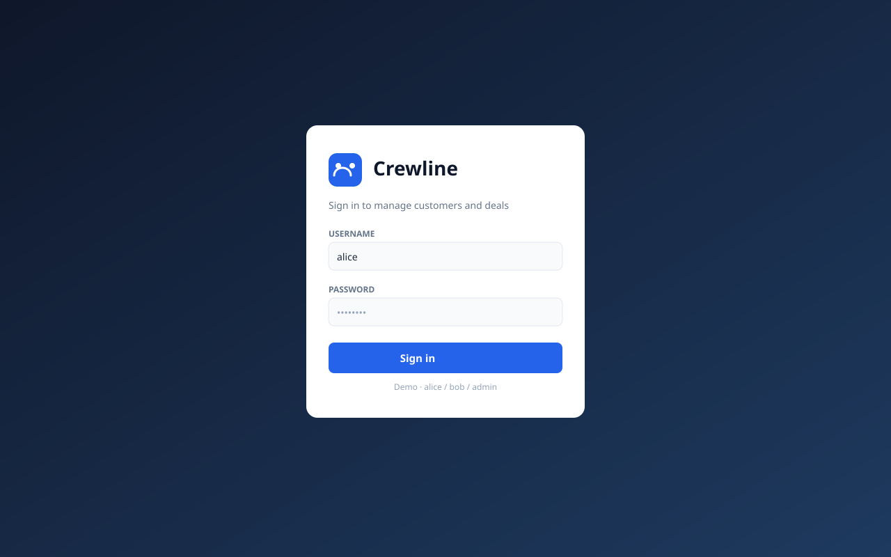
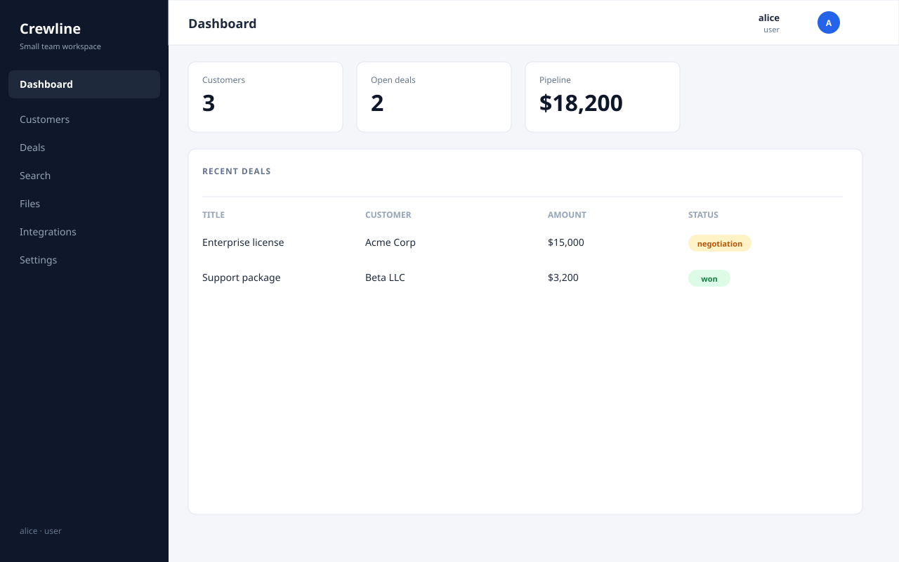
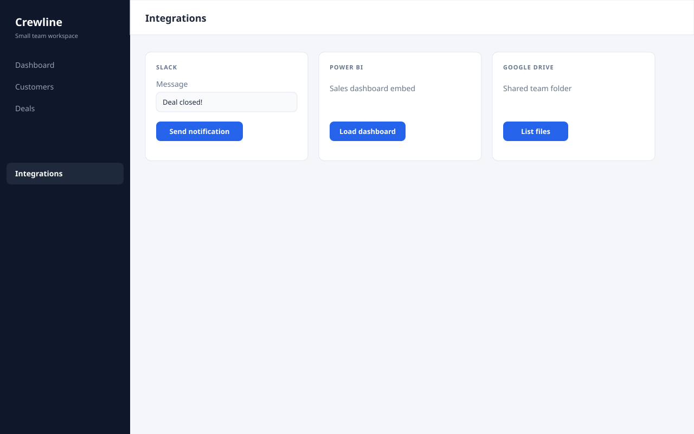

<p align="center">
  
</p>

<p align="center">
  <strong>Modern CRM for small teams</strong><br/>
  Customers · Deals · Files · Slack · Power BI · Google Drive
</p>

<p align="center">
  <a href="#quick-start">Quick start</a> ·
  <a href="#features">Features</a> ·
  <a href="#screenshots">Screenshots</a> ·
  <a href="#api-overview">API</a>
</p>

---

**Crewline** is a lightweight customer relationship workspace built for teams of up to ~10 people.  
Track accounts, close deals, share files, and keep Slack / Power BI / Drive in the same loop — without enterprise bloat.

## Screenshots

| Login | Dashboard | Integrations |
|:---:|:---:|:---:|
|  |  |  |

## Features

- **Authentication** — JWT-based sign-in for your team
- **Customers** — directory with notes and ownership
- **Deals pipeline** — amounts, status, linked accounts
- **Search** — find companies and notes quickly
- **Files** — document upload and report export
- **Integrations**
  - Slack notifications
  - Power BI sales dashboard
  - Google Drive shared folder
- **Team settings** — members and workspace diagnostics

## Quick start

```bash
git clone https://github.com/kan0n1r/crewline.git
cd crewline
cp .env.example .env
npm install
npm start
```

Open **http://localhost:3000**

### Demo accounts

| Username | Password  | Role  |
|----------|-----------|-------|
| admin    | admin123  | admin |
| alice    | alice123  | user  |
| bob      | bob123    | user  |
| carol    | carol123  | user  |
| dave     | dave123   | user  |

## Configuration

| Variable             | Description                 | Default |
|----------------------|-----------------------------|---------|
| `PORT`               | HTTP port                   | `3000`  |
| `JWT_SECRET`         | Token signing secret        | see `.env.example` |
| `SLACK_WEBHOOK`      | Slack incoming webhook      | —       |
| `POWERBI_TOKEN`      | Power BI embed / API token  | —       |
| `GOOGLE_DRIVE_TOKEN` | Google Drive access token   | —       |

## Brand assets

| File | Use |
|------|-----|
| [`assets/logo.svg`](assets/logo.svg) | App icon / mark |
| [`assets/logo-wordmark.svg`](assets/logo-wordmark.svg) | Light backgrounds |
| [`assets/logo-wordmark-dark.svg`](assets/logo-wordmark-dark.svg) | Dark backgrounds |
| [`assets/favicon.svg`](assets/favicon.svg) | Favicon |

## Project structure

```
crewline/
├── package.json
├── server.js
├── .env.example
├── assets/              # logos
├── docs/
│   ├── openapi.yaml     # OpenAPI 3.0 contract
│   └── screenshots/     # product shots
├── public/index.html    # UI
└── uploads/
```

## API overview

| Method | Path                         | Description              |
|--------|------------------------------|--------------------------|
| POST   | `/api/login`                 | Sign in                  |
| POST   | `/api/logout`                | Sign out                 |
| GET    | `/api/me`                    | Current user             |
| GET    | `/api/customers`             | List customers           |
| GET    | `/api/customers/:id`         | Customer by id           |
| POST   | `/api/customers/:id/notes`   | Update notes             |
| GET    | `/api/search?q=`             | Search                   |
| GET    | `/api/deals`                 | Deals pipeline           |
| POST   | `/api/upload`                | Upload file              |
| GET    | `/api/export?format=`        | Export report            |
| POST   | `/api/integrations/slack`    | Slack notify             |
| GET    | `/api/integrations/powerbi`  | Power BI dashboard       |
| GET    | `/api/integrations/gdrive`   | Google Drive files       |
| POST   | `/api/integrations/fetch`    | Fetch URL helper         |
| GET    | `/api/users`                 | Team members             |
| POST   | `/api/users/update`          | Update profile           |
| GET    | `/api/health`                | Health check             |

## Tech stack

- **Runtime:** Node.js  
- **Framework:** Express  
- **Database:** SQLite (in-memory demo)  
- **Auth:** JWT (cookie / Bearer)  
- **Uploads:** Multer  

## Production notes

1. Use a persistent database (PostgreSQL / MySQL).
2. Keep secrets in environment variables or a vault.
3. Enable HTTPS and secure cookie flags.
4. Restrict integration tokens and outbound URLs.
5. Put a reverse proxy (nginx / Caddy) in front with rate limits.


## Test data

On startup the in-memory database is seeded with:

| Entity | Count | Notes |
|--------|------:|-------|
| Users | 5 | `admin`, `alice`, `bob`, `carol`, `dave` (password = username + `123`) |
| Customers | 8 | Acme, Beta, Gamma, Delta, Epsilon, Zeta, Omega, Nova |
| Deals | 8 | Statuses: negotiation, won, proposal, qualification, lost |

Machine-readable fixtures (for Postman, scripts, LLM harnesses):

| File | Content |
|------|---------|
| [`test/fixtures/users.json`](test/fixtures/users.json) | Team accounts |
| [`test/fixtures/customers.json`](test/fixtures/customers.json) | Customer rows |
| [`test/fixtures/deals.json`](test/fixtures/deals.json) | Pipeline rows |
| [`test/fixtures/api-samples.json`](test/fixtures/api-samples.json) | Sample requests per endpoint + seed snapshot |

Smoke test against a running server:

```bash
npm start &
./scripts/smoke-api.sh
# or: BASE_URL=http://localhost:3000 ./scripts/smoke-api.sh
```

## API specification (OpenAPI)

Machine-readable contract: [`docs/openapi.yaml`](docs/openapi.yaml) (OpenAPI **3.0.3**).

View locally with any Swagger / Redoc UI, for example:

```bash
npx @redocly/cli preview-docs docs/openapi.yaml
# or
npx swagger-ui-watcher docs/openapi.yaml
```

Import the same file into Postman, Insomnia, or Stoplight.

## License

Internal evaluation / demo use. Adjust for your organization as needed.

---

<p align="center">
  
  <br/>
  <sub>Crewline — keep the crew aligned with every customer.</sub>
</p>
